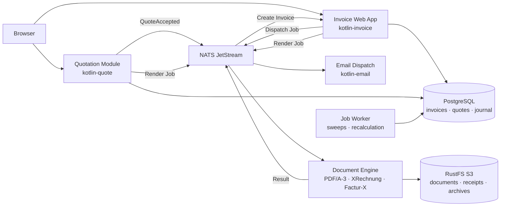

<!--
  Project: Little Trotter X-Invoice
  Copyright (c) 2026 Eifel42 Stefan Zils
  See LICENSE and NOTICE for license terms.
-->

# Little Trotter

<p align="center">
  
</p>

**E-invoicing for small and medium businesses.**

Little Trotter is a modular open-source software for electronic invoicing (EN 16931, ZUGFeRD / Factur-X, XRechnung) and commercial quotation authoring (*Angebotswesen*). Designed for craft businesses, engineering offices, freelancers, and small to medium-sized enterprises (SMEs), it pairs an ergonomic, keyboard-driven UI with complete local data sovereignty (*Local-First*).

> **Notice:**
> - **Transparency & AI Assistance:** This documentation and its architectural artifacts are authored and maintained with the assistance of advanced AI development agents.
> - **Synthetic Test Data (`datagen`):** All companies, individuals, addresses, and amounts in documentation and screenshots are randomly generated synthetic test data and represent no real entities.
> - **Legal & Tax Advisory Notice:** Little Trotter provides technical generation and validation of structured e-invoices. It does not provide legal or tax advice. Compliance with statutory retention obligations (e.g., GoBD) remains the operator's responsibility in consultation with their tax advisor.
> - **Beta & Development Stack:** Active beta development. The local development stack (`make dev`) is intended for evaluation and architecture review; production use requires hardened, professionally administered infrastructure.

---

## 30-Second Tour: Document Lifecycle

| Commercial Step | System Processing |
|---|---|
| **Write Quote** | Formal quotation authoring (*Angebotswesen*), itemized scope, and one-click conversion of accepted quotes directly into invoice drafts. |
| **Record Invoice** | Automatic application of VAT rules (domestic, EU reverse charge), travel and per-diem calculation, and formal validation checks prior to finalization. |
| **Finalize & Lock** | Assigns the official invoice number, freezes the document against modification, renders PDF/A-3 with embedded XML (XRechnung / Factur-X), validates against KoSIT Schematron rules, and seals with a cryptographic checksum. |
| **Attach Receipts** | Hotel bills, tickets, or delivery notes are verified for duplicates (SHA-256) in the receipt pool and embedded into PDF and XML containers within strict size budgets. |
| **Correct (Storno)** | Creates a compliant cancellation document (type 384) alongside the original with inverted signs; records are never overwritten or deleted. |
| **Commercial Excel Export** | Generates structured workbooks per invoice or period with typed cells, dynamic control formulas for internal reconciliations, and journal sheets. |

---

## Commercial and Technical Principles

### Compliance by Architecture
- **E-Invoicing Standards:** Full support for Factur-X / ZUGFeRD 2.x and XRechnung 3.0.x under European standard EN 16931.
- **Integrated Verification Gates:** Automated validation against official KoSIT Schematron rules and veraPDF PDF/A-3 conformance suites prior to invoice locking.
- **Immutability & Audit Trail:** Append-only database journal with state-based write locks and cryptographic checksums. Archiving responsibility remains with the operator (e.g., handover to mail/DMS archive).

### Practical B2B & Crafts Requirements
- **Buyer B2B Profiles:** Configurable customer-specific references including Buyer Reference / Leitweg-ID (`BT-10`), Purchase Order (`BT-13`), and Project Reference (`BT-11`).
- **Customer Article Numbers:** Maps external customer article references to internal catalogs.
- **Cross-Border Tax Identifiers:** Supports multiple VAT ID registrations (e.g., DE and LU) for cross-border operations within the European single market.
- **Crafts Profile Notices (B2C):** Automated statutory notices on invoices to private consumers (two-year retention requirement for building/property work, itemized split of labor, machinery, and travel costs).

### Cost Efficiency & Digital Sovereignty
- **Zero License or Transaction Fees:** Open-source model with no seat licenses, subscription tiers, or per-invoice network fees.
- **Minimal Resource Footprint:** Runs on entry-level hardware (e.g., low-power mini PCs) with support for scheduled overnight shutdown; no ongoing cloud lock-in.
- **Full Data Sovereignty (Local-First):** All documents, receipts, and databases reside on local storage. No external data transfer without explicit document dispatch.

---

## System Architecture

Little Trotter is built on a hexagonal architecture with Domain-Driven Design (DDD) and narrow role ports:



- **Web Application (`kotlin-invoice`):** Kotlin 2.x and Quarkus 3.x backend with a calm, keyboard-friendly server-side Vaadin Flow UI; no extra REST layer or SPA overhead.
- **Document Engine (`kotlin-xpdf`):** Decoupled DIN 5008 PDF/A-3 rendering using Typst (Rust), Mustang (ZUGFeRD/Factur-X), and Apache PDFBox (ADR-030).
- **Quotation Module (`kotlin-quote`):** Dedicated SCS for commercial quote authoring with UBL Quotation XML and seamless invoice generation.
- **Email Service (`kotlin-email`):** Dedicated SCS for secure B2B invoice delivery (SMTP/TLS, Ed25519-signed archive packages) via NATS JetStream.
- **Infrastructure Services:** Native/containerized PostgreSQL (transactional primary storage), Valkey (cache), RustFS (S3-compatible object storage), and NATS JetStream (event and job backbone).

---

## Quickstart with Docker Compose

Requires Docker (Compose v2) and `make`:

```bash
# Generate random credentials in .env (one-time setup)
make secrets

# Start all 7 containers, apply database migrations, and initialize
make dev
```

Open **http://localhost:8080**. Stop the stack with `make dev-down` (data in PostgreSQL and S3 volumes is preserved).

> *Note:* The `make dev` environment is unauthenticated and intended strictly for local development and technical evaluation.

---

## Quality Assurance & Verification Gates

| Gate | Guarantee |
|---|---|
| **Four Test Layers**<br>*(>16,000 automated tests across 2,250+ suites)* | - **Unit Tests:** 1,859 test classes with isolated mocks (`*Test.kt`), no network or database dependencies (>14,000 checks).<br>- **Integration Tests (IT):** 299 test classes (`*IT.kt`) against real containers (PostgreSQL, NATS JetStream, RustFS) via Testcontainers (>2,000 checks).<br>- **Cross-Module E2E:** 99 pipeline runs (`kotlin-e2e-tests`) through the real document pipeline.<br>- **E2E Browser Tests:** Maintained in operations tooling (`little-trotter-admin-tools/e2e-test-playwright`, Playwright with 70+ test suites and >250 browser interactions on the live stack; publication scheduled earliest Q4/2027). |
| **90/90 Coverage Gate** | Minimum 90% line and 90% branch coverage on the aggregate report of `make test` — strictly enforced without exception. |
| **Static Code Analysis** | ktlint, detekt (ratchet baseline rule), sqlfluff for DDL migrations, Qodana at zero errors, SonarQube Community code analysis. |
| **Supply Chain Security** | Gitleaks pre-commit secret scanning, OWASP Dependency-Check, CycloneDX SBOM generation, Trivy container image scans. |
| **Standards Conformance** | Official KoSIT validation scenarios for XRechnung, veraPDF PDF/A-3 validation suite, and ZUGFeRD reference profiles. |

---

## Roadmap & Philosophy

### Open Source as Cooperative Self-Help
Rooted in the cooperative philosophy of **Friedrich Wilhelm Raiffeisen**:
> *"Was dem Einzelnen nicht möglich ist, das vermögen viele."*  
> *(What is impossible for one alone, many can achieve.)*

Independent businesses face identical regulatory challenges (GoBD, mandatory e-invoicing). Open source provides durable, shared infrastructure ensuring independence from proprietary cloud monopolies.

### Release Names & Commercial Value
Releases are named after working horse breeds, inspired by the German analogy of **ZUGFeRD** to **Zugpferd** (draft horse):

- **Haflinger (Core Invoicing Engine):** Sure-footed working breed. Represents the robust foundation: EN 16931, ZUGFeRD 2.x, and XRechnung verified before dispatch, SHA-256 duplicate detection in the receipt pool, cancellation documents (type 384), and audit journals.
- **Andalusian (B2B Document Dispatch):** Agile courier horse. Fast, tamper-evident invoice delivery (Ed25519 signatures, SMTP/TLS, NATS JetStream) accelerating cashflow and reducing Days Sales Outstanding (DSO) without third-party network fees.
- **Black Forest Fox (*Schwarzwälder Fuchs*, Commercial Quotations):** Tenacious cold-blood breed bred for steep mountain labor; a tribute to family heritage in forestry, agriculture, and slate transport. Drives sales efficiency through seamless quote authoring (`kotlin-quote`, UBL Quotation XML) and one-click invoice conversion.
- **Percheron (International Profiles & Scale):** Powerful draft breed. Cross-border Factur-X profiles (France, Luxembourg, Belgium) and multi-tenancy for expanding enterprises.

---

## Glossary & Reference Documentation

Definitions covering e-invoicing standards (EN 16931, ZUGFeRD, XRechnung), legal frameworks (GoBD, UStG), and architecture concepts are maintained in the central documentation hub:
- [Business & Legal Glossary](arc42-docs/doc/glossar.adoc) (`glossar.html`)
- [Architecture Glossary](arc42-docs/doc/architecture-glossary.adoc) (`architecture-glossary.html`)
- Complete arc42 architecture documentation in `arc42-docs/`.

---

## License & Attribution

- **Software:** [Apache License 2.0](LICENSE).
- **Concept & Documentation:** [CC BY 4.0](https://creativecommons.org/licenses/by/4.0/) — credit *Little Trotter (https://github.com/little-trotter/invoice)*.
- **Project Initiator:** Stefan Zils ([Eifel42](https://github.com/eifel42)).
- Third-party notices and font licenses are listed in [NOTICE](NOTICE).
